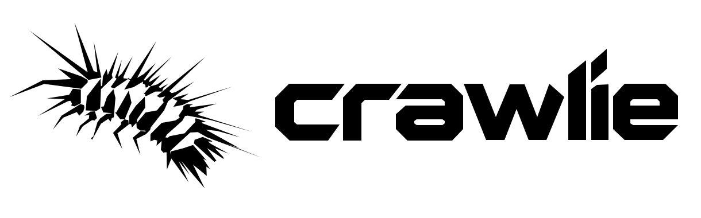

# Crawlie

<picture>
  <source media="(prefers-color-scheme: dark)" srcset="assets/brand/svg/crawlie-horizontal-white.svg">
  <source media="(prefers-color-scheme: light)" srcset="assets/brand/svg/crawlie-horizontal-black.svg">
  
</picture>

A graph-based crawler project written in Zig. Early development.

## License

[ISC](LICENSE)
