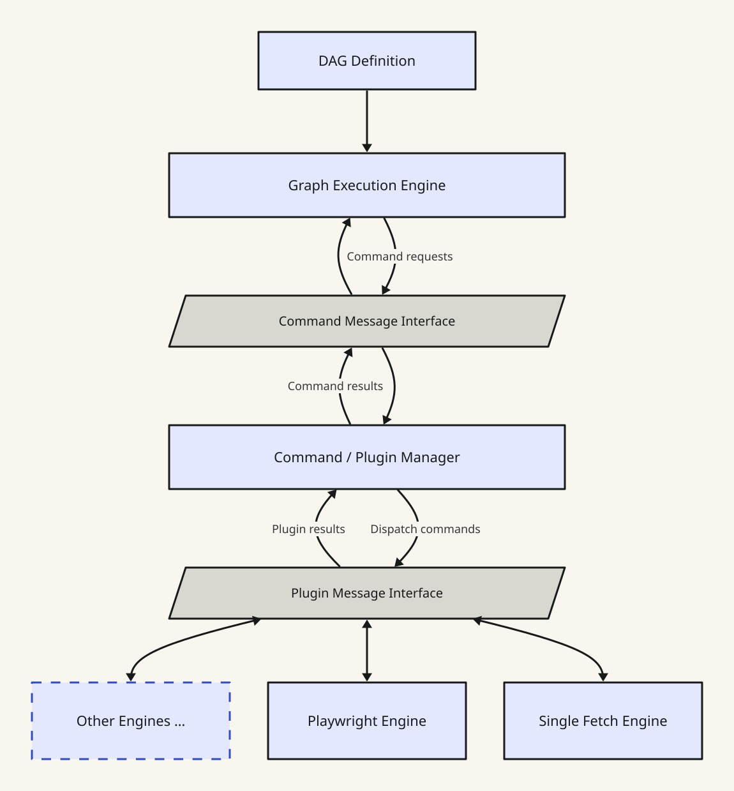

# Crawlie Architecture

The DAG Definition feeds the Graph Execution Engine. The graph engine exchanges
command requests and results with the Command / Plugin Manager through the
**Command Message Interface**.

The manager dispatches commands and receives plugin results through the
**Plugin Message Interface**, shared by Single Fetch, Playwright, and additional
engine plugins. Single Fetch handles HTTP fetching; Playwright handles browser
automation. Commands flow toward the plugins, and results return toward the graph.
